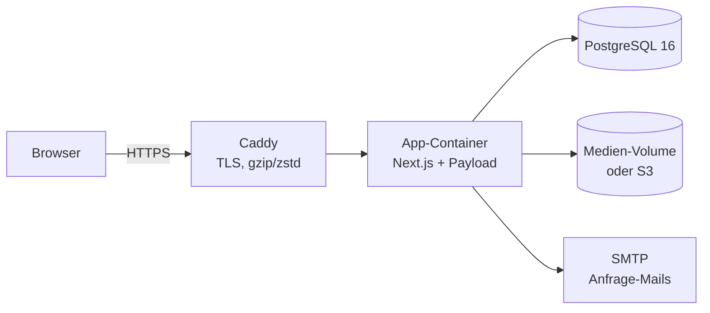

# Betriebshandbuch

## Architektur



- **App:** ein Container (`node server.js`) mit Website, Admin (`/admin`) und API. Er läuft als Benutzer `nextjs` (uid 1001).
- **Datenbank:** PostgreSQL 16. Migrationen (`src/migrations`) laufen beim Start automatisch (`prodMigrations`).
- **Medien:** Volume `/app/media`. Alternativ S3-kompatibler Speicher in der EU (`S3_*`-Variablen).
- **Health-Check:** `GET /api/health` → `{"ok":true}` (prüft CMS und Datenbank). Wird vom Docker-HEALTHCHECK genutzt.
- **REST-API:** für Gäste geschlossen. Die Website liest Inhalte serverseitig. Öffentlich sind nur Medien (`/api/media/…`) und die Website-Endpunkte `/api/preis`, `/api/konfiguration`, `/api/anfrage`, `/api/health`.

## Erstinstallation (Docker Compose)

```bash
git clone <repo> /opt/schaftboeller && cd /opt/schaftboeller
cp .env.example .env.production
openssl rand -hex 32        # → PAYLOAD_SECRET
openssl rand -hex 24        # → POSTGRES_PASSWORD
# .env.production ausfüllen: SERVER_URL, DOMAIN, SMTP_*, MAIL_FROM_*, beim ersten Start SEED_ON_INIT=true + SEED_ADMIN_*
docker compose --env-file .env.production --profile tls up -d --build
docker compose --env-file .env.production logs -f app
```

- Nach dem ersten erfolgreichen Start `SEED_ON_INIT=false` setzen und `SEED_ADMIN_PASSWORD` aus der Datei entfernen. Danach unter `/admin/account` ein eigenes Passwort setzen.
- DNS: A/AAAA-Einträge für `DOMAIN` und `www.DOMAIN` auf den Server. Caddy holt die Zertifikate automatisch.
- Ohne das Profil `tls` lauscht die App nur auf `127.0.0.1:3000`, dann übernimmt ein vorhandener Reverse-Proxy TLS.

## Umgebungsvariablen

Alle Variablen sind in [`.env.example`](../../.env.example) beschrieben. Zu beachten:

| Variable | Hinweis |
|---|---|
| `SERVER_URL` | Öffentliche Adresse. Wird zur Laufzeit gelesen, dasselbe Image funktioniert für Staging und Produktion |
| `PAYLOAD_SECRET` | Nie ändern, sonst werden alle Anmeldungen ungültig |
| `SMTP_*` | Ohne `SMTP_HOST` werden E-Mails nur ins Log geschrieben |
| `SITE_NOINDEX=true` | Für Staging: `robots.txt` sperrt alles, Seiten sind `noindex` |
| `PLAUSIBLE_DOMAIN`, `PLAUSIBLE_SCRIPT_URL` | Build-Argumente: fließen in die Content-Security-Policy ein, daher nach Änderung neu bauen |
| `RATE_LIMIT_INQUIRIES` | Anfragen pro IP in 10 Minuten (Standard 5) |
| `TRUSTED_PROXY_HOPS` | Anzahl der Reverse-Proxys vor der App (Standard 1). Bestimmt, welcher Eintrag aus `X-Forwarded-For` als Client-IP gilt. Bei eigenem Proxy statt Caddy: `X-Forwarded-For` anhängen (nginx: `$proxy_add_x_forwarded_for`) |

## Updates einspielen

```bash
cd /opt/schaftboeller
git pull
docker compose --env-file .env.production --profile tls up -d --build
```

Migrationen laufen beim Start. Vorher ein Backup ziehen (siehe unten). Abhängigkeiten werden über Pull-Requests aktualisiert; die CI muss grün sein.

## Backups

[`deploy/backup.sh`](../../deploy/backup.sh) sichert die Datenbank (`pg_dump`) und die Medien und behält 14 Stände:

```cron
15 3 * * * cd /opt/schaftboeller && ./deploy/backup.sh >> /var/log/schaftboeller-backup.log 2>&1
```

**Wichtig:** Das Backup-Verzeichnis zusätzlich extern sichern (z. B. Storage-Box, `restic`). Die Wiederherstellung steht am Ende des Skripts. Mindestens einmal pro Quartal testweise wiederherstellen.

## Monitoring

- Uptime-Check auf `https://<domain>/api/health` (z. B. Uptime Kuma, Better Stack). Alarm per E-Mail.
- Logs: `docker compose logs app`. Fehler beim Mailversand oder bei der PDF-Erzeugung erscheinen dort; die Anfrage bleibt trotzdem im CMS gespeichert.

## Entwicklung → Produktion

1. Änderungen im Branch, Pull-Request. Die CI prüft Lint, Typen, Unit-Tests, Migrationen, Build, E2E und Docker-Build.
2. Bei Änderungen am Datenmodell: `npm run migrate:create -- <name>` und die Migration committen. Die CI schlägt fehl, wenn sie fehlt.
3. Nach dem Merge auf dem Server: `git pull && docker compose … up -d --build`.

## Phase 2 (Shop) – Anknüpfungspunkte

- `lib/configurator/engine.ts` (`quote`, `validateSelection`) und `lib/configurator/server.ts` (`saveConfiguration`) bilden die verbindliche Preisberechnung. Warenkorb und Kasse nutzen sie direkt.
- `configurations` enthält bereits eine Preis-Momentaufnahme. Bestellungen verweisen künftig darauf.
- Rechtstexte (AGB, Widerruf, Versand & Zahlung) sind als weitere Einträge in „Rechtstexte“ möglich und automatisch unter `/<slug>` erreichbar.
- Zahlungsarten je Warenkorb-Inhalt (Böller: Vorkasse/Anzahlung/Abholung) – siehe Konzept, Kapitel 11 und 12.
