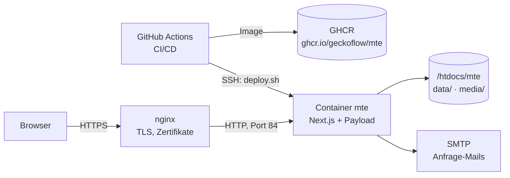

# Betriebshandbuch

## Architektur



- **App:** ein Container `mte` (`node server.js`) mit Website, Admin (`/admin`) und API. Er läuft als Benutzer `nextjs` (uid 1001) und ist auf **Port 84** des Servers erreichbar. Er spricht nur HTTP; HTTPS und Zertifikate übernimmt nginx davor. Gestartet wird er wie aquaconfig (lamprecht): `docker run -d --name mte --restart unless-stopped -p 84:3000 -v /htdocs/mte:/htdocs/mte …`.
- **Daten auf dem Server unter `/htdocs/mte`** (vom Host in den Container gemountet):
  - `.env.production`: Konfiguration
  - `data/schaftboeller.db`: SQLite-Datenbank (libSQL) im WAL-Modus, daneben `-wal` und `-shm`. Entsteht beim ersten Start, Migrationen (`src/migrations`) laufen beim Start automatisch (`prodMigrations`)
  - `media/`: hochgeladene Bilder. Alternativ S3-kompatibler Speicher in der EU (`S3_*`-Variablen)
- **Nur eine Instanz:** SQLite erlaubt einen Schreiber zur selben Zeit. Die App deshalb nicht mehrfach parallel starten.
- **Health-Check:** `GET /api/health` → `{"ok":true}` (prüft CMS und Datenbank). Docker-HEALTHCHECK und Deploy warten darauf.
- **REST-API:** für Gäste geschlossen. Die Website liest Inhalte serverseitig. Öffentlich sind nur Medien (`/api/media/…`) und die Website-Endpunkte `/api/preis`, `/api/konfiguration`, `/api/anfrage`, `/api/health`.

> **Achtung:** `/htdocs/mte` enthält Datenbank (mit Anfragen und Passwort-Hashes) und Zugangsdaten. Das Verzeichnis darf **nicht** von einem Webserver ausgeliefert werden.

## CI/CD-Pipeline

[`.github/workflows/ci.yml`](../../.github/workflows/ci.yml), aufgebaut wie bei aquaconfig:

| Job | Wann | Was |
|---|---|---|
| Lint, Typen, Unit-Tests | jeder PR und Push auf `main` | ESLint, TypeScript, Vitest |
| Build und End-to-End-Tests | danach | Migrationsprüfung, Produktions-Build, Playwright gegen den Standalone-Server |
| Image bauen | danach | Docker-Image; außerhalb von PRs nach `ghcr.io/geckoflow/mte` mit Tag = erste 8 Zeichen des Commits, auf `main` zusätzlich `latest` |
| Deploy nach Production | nur Push auf `main` | per SSH [`deploy/deploy.sh`](../../deploy/deploy.sh) auf dem Server: Image laden, Container `mte` ersetzen, auf den Health-Check warten |

**Einrichtung in GitHub** (Settings → Environments → `production`, Secrets wie bei aquaconfig):

| Secret | Inhalt |
|---|---|
| `SSH_PRIVATE_KEY` | privater Schlüssel des Deploy-Benutzers |
| `SSH_HOST` | Server |
| `SSH_USER` | Benutzer auf dem Server, darf `docker` ausführen |

Fehlen die Secrets, überspringt die Pipeline den Deploy mit einer Warnung; das Image liegt trotzdem in GHCR. Die Anmeldung an GHCR (Push und Pull) läuft über den automatischen `GITHUB_TOKEN`, dafür ist nichts einzustellen.

Optionale Variablen (Settings → Secrets and variables → Actions → Variables), alle mit sinnvollem Standard:

| Variable | Standard | Wofür |
|---|---|---|
| `APP_PORT` | `84` | Port auf dem Server |
| `APP_BIND` | leer (alle Adressen, wie aquaconfig) | `127.0.0.1`, wenn nginx auf demselben Server läuft: Port 84 ist dann von außen nicht erreichbar |
| `APP_DIR` | `/htdocs/mte` | Datenverzeichnis auf dem Server |
| `PLAUSIBLE_DOMAIN`, `PLAUSIBLE_SCRIPT_URL` | leer | nur für Plausible-Statistik: fließen beim Image-Build in die Content-Security-Policy ein |

Alles andere (`PAYLOAD_SECRET`, `SERVER_URL`, SMTP …) steht nicht in GitHub, sondern in `/htdocs/mte/.env.production` auf dem Server.

**Rollback:** In GitHub unter Actions den Lauf eines älteren Stands öffnen und den Job „Deploy nach Production“ erneut ausführen. Oder auf dem Server: `deploy.sh ghcr.io/geckoflow/mte:<tag>`.

## Erstinstallation auf dem Server

Einmalig, danach deployt die Pipeline bei jedem Merge auf `main`:

```bash
sudo mkdir -p /htdocs/mte
sudo cp .env.example /htdocs/mte/.env.production   # Vorlage aus dem Repository
sudo chmod 600 /htdocs/mte/.env.production
openssl rand -hex 32                                 # → PAYLOAD_SECRET
# ausfüllen: SERVER_URL, SMTP_*, MAIL_FROM_*, TRUSTED_PROXY_HOPS, beim ersten Start SEED_ON_INIT=true + SEED_ADMIN_*
```

- nginx für die Domain einrichten (Zertifikate wie bei den anderen Seiten), siehe unten. In `.env.production` `TRUSTED_PROXY_HOPS=1` lassen.
- Port 84 sollte von außen nicht erreichbar sein: Wer direkt zugreift, umgeht HTTPS und kann die Client-IP für das Rate-Limit fälschen. Läuft nginx auf demselben Server, die Variable `APP_BIND=127.0.0.1` setzen. Eine Firewall-Regel (ufw) allein reicht nicht, weil Docker veröffentlichte Ports an ufw vorbei freigibt.
- `data/` und `media/` legt der Deploy selbst an und gibt sie uid 1001.
- Nach dem ersten erfolgreichen Deploy `SEED_ON_INIT=false` setzen und `SEED_ADMIN_PASSWORD` aus der Datei entfernen. Danach unter `/admin/account` ein eigenes Passwort setzen. Änderungen an `.env.production` wirken beim nächsten Deploy (oder sofort mit `deploy.sh ghcr.io/geckoflow/mte:latest` auf dem Server).
- DNS: A/AAAA-Einträge für die Domain und `www.` auf den Server.

nginx (Ausschnitt). Läuft nginx auf einem anderen Server, statt `127.0.0.1` dessen Adresse zum App-Server eintragen:

```nginx
server {
  listen 443 ssl;
  server_name schaftboeller-ebner.at;
  # ssl_certificate …; ssl_certificate_key …;   (wie bei den übrigen Seiten)

  client_max_body_size 25m;   # Bild-Uploads im Admin (Standard von nginx: 1 MB)

  location / {
    proxy_pass http://127.0.0.1:84;
    proxy_set_header Host $host;
    proxy_set_header X-Forwarded-For $proxy_add_x_forwarded_for;
    proxy_set_header X-Forwarded-Proto $scheme;
  }
}

# HTTP und www auf die Hauptdomain umleiten
server {
  listen 80;
  server_name schaftboeller-ebner.at www.schaftboeller-ebner.at;
  return 301 https://schaftboeller-ebner.at$request_uri;
}
server {
  listen 443 ssl;
  server_name www.schaftboeller-ebner.at;
  # ssl_certificate …; ssl_certificate_key …;
  return 301 https://schaftboeller-ebner.at$request_uri;
}
```

**Alternative ohne Pipeline:** [`docker-compose.yml`](../../docker-compose.yml) baut das Image auf dem Server und bringt mit dem Profil `tls` einen eigenen Caddy für HTTPS mit (`docker compose --env-file .env.production --profile tls up -d --build`). Die Daten liegen dann in den Docker-Volumes `data` und `media`.

## Umgebungsvariablen

Alle Variablen sind in [`.env.example`](../../.env.example) beschrieben. Zu beachten:

| Variable | Hinweis |
|---|---|
| `SERVER_URL` | Öffentliche Adresse. Wird zur Laufzeit gelesen, dasselbe Image funktioniert für Staging und Produktion |
| `DATABASE_URL`, `MEDIA_DIR` | Setzt der Deploy fest auf `/htdocs/mte/data/schaftboeller.db` und `/htdocs/mte/media`; Werte in `.env.production` werden überschrieben |
| `PAYLOAD_SECRET` | Nie ändern, sonst werden alle Anmeldungen ungültig |
| `SMTP_*` | Ohne `SMTP_HOST` werden E-Mails nur ins Log geschrieben |
| `SITE_NOINDEX=true` | Für Staging: `robots.txt` sperrt alles, Seiten sind `noindex` |
| `PLAUSIBLE_DOMAIN`, `PLAUSIBLE_SCRIPT_URL` | Zur Laufzeit in `.env.production` (Skript-Tag) **und** als Repository-Variablen für den Image-Build (Content-Security-Policy) |
| `RATE_LIMIT_INQUIRIES` | Anfragen pro IP in 10 Minuten (Standard 5) |
| `TRUSTED_PROXY_HOPS` | Anzahl der Reverse-Proxys vor der App (Standard 1 = nginx). Bestimmt, welcher Eintrag aus `X-Forwarded-For` als Client-IP gilt. nginx muss `X-Forwarded-For` anhängen (`$proxy_add_x_forwarded_for`) |

## Updates einspielen

Pull-Request auf `main` mergen: Die Pipeline testet, baut das Image und deployt. Migrationen laufen beim Start des neuen Containers. Bei Änderungen am Datenmodell vorher ein Backup ziehen (siehe unten). Abhängigkeiten werden über Pull-Requests aktualisiert; die CI muss grün sein.

## Backups

[`deploy/backup.sh`](../../deploy/backup.sh) sichert Datenbank und Medien aus dem laufenden Container `mte` und behält 14 Stände. Die Datenbank wird mit `VACUUM INTO` konsistent kopiert (`db_<Datum>.db.gz`). Die Datei **nicht** einfach mit `cp` kopieren, solange die App läuft: Ein Teil der Daten steht dann noch in der `-wal`-Datei.

```bash
scp deploy/backup.sh <server>:/usr/local/bin/mte-backup   # einmalig, ausführbar machen
```

```cron
15 3 * * * /usr/local/bin/mte-backup >> /var/log/mte-backup.log 2>&1
```

**Wichtig:** Das Backup-Verzeichnis (`/var/backups/mte`) zusätzlich extern sichern (z. B. Storage-Box, `restic`). Mindestens einmal pro Quartal testweise wiederherstellen.

Wiederherstellen (als root, steht auch am Ende des Skripts). Dabei die alten `-wal`/`-shm`-Dateien löschen, sonst spielt SQLite veraltete Änderungen auf die zurückgeholte Datei:

```bash
docker stop mte
rm -f /htdocs/mte/data/schaftboeller.db-wal /htdocs/mte/data/schaftboeller.db-shm
gunzip -c /var/backups/mte/db_<STAMP>.db.gz > /htdocs/mte/data/schaftboeller.db
tar -C /htdocs/mte -xzf /var/backups/mte/media_<STAMP>.tar.gz
chown -R 1001:1001 /htdocs/mte/data /htdocs/mte/media
docker start mte
```

## Monitoring

- Uptime-Check auf `https://<domain>/api/health` (z. B. Uptime Kuma, Better Stack). Alarm per E-Mail.
- Logs: `docker logs mte`. Fehler beim Mailversand oder bei der PDF-Erzeugung erscheinen dort; die Anfrage bleibt trotzdem im CMS gespeichert.

## Entwicklung → Produktion

1. Änderungen im Branch, Pull-Request auf `main`. Die Pipeline prüft Lint, Typen, Unit-Tests, Migrationen, Build, E2E und das Docker-Image.
2. Bei Änderungen am Datenmodell: `npm run migrate:create -- <name>` und die Migration committen. Die CI schlägt fehl, wenn sie fehlt.
3. Merge auf `main` → Image in GHCR → Deploy auf den Server.

## Phase 2 (Shop) – Anknüpfungspunkte

- `lib/configurator/engine.ts` (`quote`, `validateSelection`) und `lib/configurator/server.ts` (`saveConfiguration`) bilden die verbindliche Preisberechnung. Warenkorb und Kasse nutzen sie direkt.
- `configurations` enthält bereits eine Preis-Momentaufnahme. Bestellungen verweisen künftig darauf.
- Rechtstexte (AGB, Widerruf, Versand & Zahlung) sind als weitere Einträge in „Rechtstexte“ möglich und automatisch unter `/<slug>` erreichbar.
- Zahlungsarten je Warenkorb-Inhalt (Böller: Vorkasse/Anzahlung/Abholung) – siehe Konzept, Kapitel 11 und 12.
