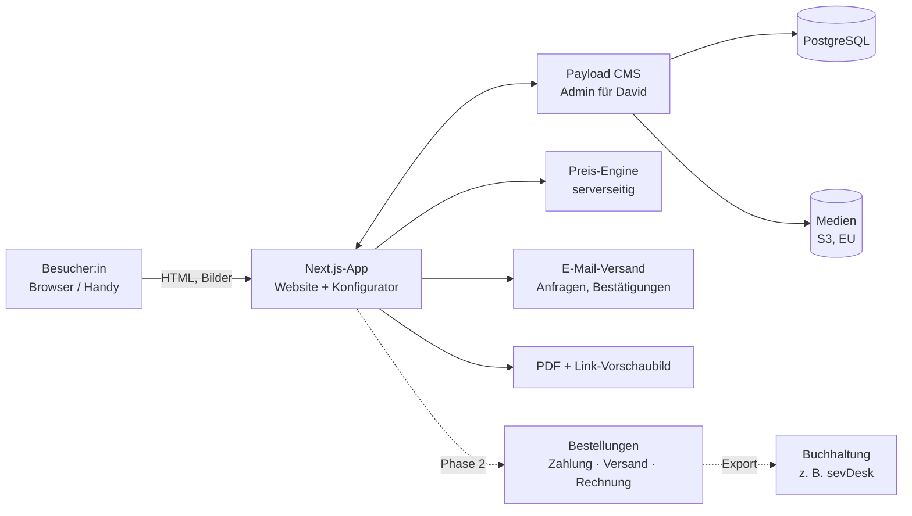

# Website-Konzept „Schaftböller Ebner“

| | |
|---|---|
| **Stand** | 15.10.2026 · Version 0.1, Entwurf zur Abstimmung |
| **Erstellt von** | gecko-flow (Johannes Winkler) |
| **Grundlage** | [Mail von David Ebner vom 14.10.2026](../briefing/2026-10-14_mail-david-ebner/README.md), Analyse der genannten Referenzseiten, Recherche zu Rechtslage und Zahlungsanbietern |
| **Prototyp** | [`prototype/index.html`](../../prototype/index.html), klickbarer Design-Prototyp (im Browser öffnen) |

---

## 0. Auf einen Blick

- **Was:** Eine Website, die **wie eine Manufaktur auftritt, nicht wie ein Onlineshop**: Schwarz-Weiß, große Typografie, Nussholz und Edelstahl als einzige „Farben“. Herzstück ist ein **Konfigurator**, in dem man sich seinen Schaftböller zusammenstellt.
- **Wie:** Zwei Ausbaustufen.
  - **Phase 1:** Website mit Konfigurator und **Anfrage**.
  - **Phase 2:** Echter **Shop** mit Warenkorb und Bestellung.
  - Daten, Preislogik und Konfigurationen sind von Anfang an so gebaut, dass der Shop eine **Erweiterung ist und kein Neubau**.
- **Technik:** Next.js und Payload CMS (TypeScript, PostgreSQL), selbst gehostet in der EU. David pflegt Produkte, Preise, Optionen und Bilder selbst. Bewusst **kein WordPress/WooCommerce und kein Shopify** (Begründung in Kapitel 10).
- **Größtes Risiko:** die **rechtliche Einordnung** des Schaftböllers: Prangerstutzen nach Waffengesetz oder Böller nach Pyrotechnikgesetz? Daran hängen Beschuss, Gewerbe, Versand und Zahlungsanbieter.
  - PayPal, Shopify Payments, Stripe und Klarna schließen Waffen aus oder schränken sie ein.
  - **Phase 1 ist davon kaum betroffen**, Phase 2 hängt daran.
- **Kritischer Pfad:** echte Produktfotos (Fotoshooting), Preise und Optionen, Logo als Vektordatei.
- **Chance:** Keiner der beiden Mitbewerber hat einen Konfigurator, einen Gesamtpreis oder einen modernen Auftritt. Mit dieser Website wird Schaftböller Ebner **der Anbieter, bei dem man den Böller online sehen, gestalten und anfragen kann.**

---

## 1. Interpretation des Mails

### 1.1 Was David ausdrücklich will

| Wunsch | Davids Worte | Umsetzung im Konzept |
|---|---|---|
| Auffällig und modern | „was einem ins Auge springt und eher Modern“ | Große Versal-Typografie, Kontrast, Vollbild-Fotografie, dezente Bewegung (Kap. 6) |
| Schwarz-Weiß | „eher Schwarz weiß wie gmgaustria.at“ | Anthrazit, Weiß und warmes Off-White. Farbe kommt nur über Holz- und Metallfotos (Kap. 6.2) |
| Logo-Intro | „am Anfang mein Logo bevor man auf die Startseite kommt“ | Intro unter 2,5 s, einmal pro Sitzung, überspringbar (Kap. 6.4) |
| Konfigurator | „wo man sich den Schaftböller zusammen stellen kann“, wie mein-zirbenbett.at „oder halt deinem Vorschlag“ | Geführter 5-Schritt-Konfigurator mit Live-Vorschau, Preis, Code, Link und Anfrage (Kap. 8) |
| Shop | Menüpunkt Warenkorb, Abschnitt „Warenkorb und Checkout“ | Phase 2 auf derselben Datenbasis (Kap. 11) |
| Selbst pflegen | „Produkte, Bilder, Beschreibungen, Preise und Verfügbarkeiten selbst bearbeiten“ | Payload-Admin auf Deutsch (Kap. 9 und 10) |

### 1.2 Was wir zwischen den Zeilen lesen

1. **Die Marke ist erst im Entstehen.** Es gibt ein frisches Canva-Logo, KI-Texte und Platzhalterfotos. David braucht neben einer Website auch **Hilfe beim Markenauftritt**: Bildsprache, Tonalität, Modellnamen.
2. **Inhalte sind der Engpass, nicht die Technik.** „Die Originalfotos kommen in Zukunft.“ Ohne gute Fotos wirkt auch das beste Design nicht. → Fotoshooting früh planen (Kap. 6.5).
3. **Der Konfigurator ist das Verkaufsargument.** Bei Mitbewerbern muss man Böller und Verzierungen einzeln aus Listen zusammensuchen. Lanner verkauft sie als Einzelprodukte, WMS hat 54 Artikel mit Codes wie „SB-SR-HiM“. Einen Gesamtpreis sieht man dort nicht.
4. **Handarbeit auf Bestellung.** Das spricht in Phase 1 für **Anfrage oder Reservierung** statt Sofortkauf. Lieferzeit „nach Vereinbarung“ ist in der Branche üblich (Lanner: ca. 8 Wochen).
5. **Die Rechtslage ist David bewusst** (siehe Ende des KI-Teils), aber ungeklärt. Wir planen sie technisch ein, ersetzen aber keine Rechtsberatung.
6. **Hinter der Marke steht wahrscheinlich ein Unternehmen.** Das Mail ging in CC an `office@metalltechnik-ebner.at`. Ob „Schaftböller Ebner“ eine Marke der Metalltechnik Ebner ist, ist für Impressum, Gewerbe und Rechnungen zu klären.
7. **Saisonalität.** Gebraucht und verschenkt wird rund um Advent und Weihnachten (z. B. Christkindlanschießen im Berchtesgadener Land), Ostern, Fronleichnam und Vereinsjubiläen. Eine Teaser-Seite **vor der Adventzeit** wäre wertvoll (Phase 0.5).

### 1.3 Bewertung der KI-Vorlage

Die Vorlage ist eine **gute Grundlage**. Struktur, Produktliste und Hinweise (serverseitige Preise, Rechtliches, Überspringbarkeit des Intros) sind richtig. Wir übernehmen sie weitgehend und ergänzen bzw. korrigieren:

| Punkt | Bewertung |
|---|---|
| Struktur (5 Bereiche, Menü) | ✅ übernommen. Logo-Klick führt zur Startseite. Konfigurator ist im Menü als Button hervorgehoben. Warenkorb erscheint erst ab Phase 2 (vorher „Anfrage“). |
| Konfigurator-Funktionen 1–8 | ✅ übernommen und ergänzt: **Beschuss AT/DE** als Option (bei beiden Mitbewerbern Standard), **Konfigurations-Code**, **PDF**, **Link-Vorschaubild** für WhatsApp |
| „Preise serverseitig“ | ✅ zentral. Eine Preis-Engine für Anzeige, Anfrage und Bestellung |
| Produktliste | ✅ übernommen. Offen: Was ist im Grundpreis enthalten (Riemen?) und gibt es mehrere Modelle oder Kaliber? |
| Texte | ⚠️ sprachlich überarbeiten (Anhang A). Aussagen wie „gleiche Bauteile und Zulieferer wie damals“ müssen **wahr und belegbar** sein (UWG). Den Namen **„Stangassinger“** nur historisch verwenden, nicht als Produktname, denn Lanner verkauft „Schaftböller Stangassinger“. |
| Rechtliches | ⚠️ Die Vorlage bleibt vage. Konkreter Stand in Kapitel 12 |
| Technik | ❌ Die Vorlage nennt kein System. Das legen wir fest (Kap. 10) |

---

## 2. Markt und Referenzen

### 2.1 Mitbewerber (Stand 15.10.2026, aus den Websites)

| | **Handböller Lanner** (Kuchl) | **Höllbacher Böllerbau / WMS** (Krispl) |
|---|---|---|
| System | Jimdo-Shop | WordPress, WooCommerce, Theme WoodMart |
| Auftritt | traditionell-rustikal, Dunkelbraun und Bordeaux | austauschbares Shop-Template, Böller zwischen Zirbenprodukten |
| Schaftböller | „Stangassinger“ 9/12 kg: 2.420–3.050 €; **„Modell Oberalm“: 2.640–2.900 €** | 24 mm, 12 kg: 2.600 € (30 mm +150 €) |
| Handböller | 16/18/20 mm: 1.400–1.540 € | 14 mm 1.300 €, 18/20 mm 1.500 € |
| Personalisierung | Gravur 70–140 €, Kerbschnitzerei 150–330 € (eigene Produkte) | Verzierungen 120–780 €, Laufgravur 60 €/Fläche |
| Zubehör | Wandhalterung 150 €, Ständer 140–170 €, Tasche 550 €, Eichenkiste 550 € | Wandhalterung 130–140 €, Koffer mit Zubehör 480 €, Hammer 50 €, Ständer 56–96 € |
| Beschuss | Auswahl AT/DE | Ferlach, DE +50 € |
| Kaufablauf | Warenkorb, PayPal oder Vorkasse, Produktion nach Geldeingang, ca. 8 Wochen | **Böller nur per mailto-Link**, Zubehör im Warenkorb |
| Schwächen | kein Gesamtbild, kein Gesamtpreis, kein Hinweis auf Alter oder Recht | Hauptprodukt mit schwächstem Bestellweg, kryptische Artikel |

**Folgerungen**
- Der Preisrahmen für einen Schaftböller liegt bei **ca. 2.400–3.000 €**. Personalisierung und Zubehör bringen zusätzlich **mehrere hundert Euro pro Auftrag**. Ein Konfigurator, der diese Zusatzleistungen gut präsentiert, wirkt sich direkt auf den Umsatz aus.
- **Namenskonflikt:** Lanner verkauft bereits einen Schaftböller „Modell Oberalm“ und nutzt „Stangassinger“ als Produktnamen. David braucht **eigene Modellnamen**. Eine Idee mit Bezug zum Logo: „Widder“, z. B. „SE Widder 20“.

### 2.2 Designreferenzen

- **GMG Austria** (Davids Stilvorbild) ist ein Waffengroßhändler aus Anif.
  - Look: Anthrazit (#22262B), Weiß und Hellgrau; Montserrat in gesperrten Versalien; Vollbild-Video im Hero; wenig Text, viel Weißraum.
  - Die Technik dahinter ist veraltet (Adobe Muse, eingestellt seit 2020, jQuery 1.8, eigene Handy-Version). → **Den Look übernehmen wir, die Technik nicht.**
- **mein-zirbenbett.at** (Vorbild für den Konfigurator): WooCommerce mit eigenem Plugin. 2D-Bildebenen über einem Grundbild, Live-Preis, teilbarer Link, „In den Warenkorb“.
  - **Stärken:** sofortiges Bild-Feedback, transparente Aufpreise.
  - **Schwächen:** 10 gleichrangige Kategorien ohne Führung, kein PDF, keine Anfrage, schwer (rund 1 MB HTML, jQuery doppelt geladen).
  - → **Wir übernehmen das Ebenen-Prinzip und machen den Ablauf geführt.**
- **Bild 007 aus dem Mail** (Agentur Homage): Schwarz-Weiß-Split, bei dem die Headline über die Grenze läuft. → umgesetzt als Kontrast-Sektion im Prototyp.

---

## 3. Ziele, Zielgruppen, Erfolgsmessung

**Ziele**
1. Schaftböller Ebner als **hochwertige Manufaktur-Marke** etablieren.
2. **Qualifizierte Anfragen** erzeugen (Phase 1), später **Direktverkauf** (Phase 2).
3. Personalisierung und Zubehör über den Konfigurator **sichtbar und verkäuflich** machen.
4. David entlasten: Preise, Produkte und Bilder **selbst pflegen**; Anfragen kommen **strukturiert** (Code, Konfiguration, PDF) statt als lose E-Mails.

**Zielgruppen**

| Zielgruppe | Bedürfnis | Was die Website liefert |
|---|---|---|
| Böllerschützen und Prangerschützen (Salzburg, Tirol, OÖ, Berchtesgadener Land, Oberbayern) | Verlässliche Qualität, Beschuss AT/DE, Beratung | Technische Daten, Beschuss-Option, FAQ, persönlicher Kontakt |
| Schützenvereine | Mehrere gleiche Stücke, einheitliche Beschriftung | Vereinsanfrage, Konfiguration teilbar (Link in der WhatsApp-Gruppe) |
| Traditionsbewusste Käufer und Sammler | Unikat mit Geschichte und Herkunft | Manufaktur-Story „Vom Baum zum Böller“, Galerie |
| Schenkende (Jubiläum, Hofübergabe, runder Geburtstag) | Persönliches Geschenk, klarer Preis | Personalisierung, Gesamtpreis, Beratung (Achtung: Kaufberechtigung, Kap. 12) |

**Kennzahlen** (cookielos gemessen, Kap. 10.4)
- Anfragen pro Monat
- Konfigurator-Trichter: Start → Übersicht → Anfrage
- geteilte Konfigurationen
- Anteil mobiler Zugriffe
- Google-Sichtbarkeit für „Schaftböller kaufen“, „Schaftböller Salzburg“, „Böller Tennengau“ u. Ä.

---

## 4. Phasenplan

| Phase | Inhalt | Ergebnis | Grober Zeitrahmen |
|---|---|---|---|
| **0 · Klärung** | Kickoff mit David, Fragen aus Kapitel 14, Rechtsklärung starten (BH Hallein, WKO, Beschussamt), Fotoshooting planen, Domain | Freigegebenes Konzept, Liste der Inhalte | 2–3 Wochen |
| **0.5 · Schnellstart** *(optional)* | One-Pager: Logo, Kurztext, Anfrageformular, Impressum, Datenschutz | Online vor der Adventzeit, erste Anfragen | ca. 1 Woche |
| **1 · Website und Konfigurator** | UI-Design, CMS, alle Seiten, Konfigurator mit Anfrage, PDF, Teilen; SEO, Barrierefreiheit, Rechtstexte | Live-Website, Anfragen mit Konfigurations-Code | ca. 8–10 Wochen ab vollständigen Inhalten |
| **2 · Shop** | Warenkorb, Kasse, Zahlungsarten, Versand, Altersprüfung, Bestellverwaltung, Rechnungen | Direktverkauf: **zuerst Zubehör, Böller sobald rechtlich geklärt** | ca. 4–6 Wochen |
| **3 · Ausbau** *(optional)* | 3D-Konfigurator aus CAD-Daten, Fertigungsstatus für Kunden, Vereinsportal, Newsletter, de-DE/de-AT | Mehr Wiedererkennung und Bindung | nach Bedarf |

> **Warum Phase 1 schon „shop-ready“ ist:** Produkte, Optionen und Preise liegen strukturiert im CMS. Die Preis-Engine läuft serverseitig. Konfigurationen werden mit Code und Preis-Snapshot gespeichert. Kundendaten und Rechtstexte sind modular. Phase 2 fügt **Warenkorb, Kasse und Bestellungen** hinzu, ohne das Vorhandene umzubauen.

---

## 5. Informationsarchitektur

### 5.1 Sitemap

```
/                              Startseite
/schaftboeller                 Übersicht Modelle
/schaftboeller/<modell>        Produktdetail (Fotos, Daten, „Konfigurieren“)
/zubehoer                      Übersicht Zubehör
/zubehoer/<produkt>            Produktdetail
/konfigurator                  Konfigurator
/konfigurator/<code>           Gespeicherte, teilbare Konfiguration (z. B. /konfigurator/SE-7F3K-92QA)
/handwerk                      Handwerk & Tradition: Manufaktur, Material, Geschichte, „Vom Baum zum Böller“
/galerie                       Fertige Unikate (wächst mit jedem Auftrag)
/faq                           Häufige Fragen
/kontakt                       Kontakt, Sonderwünsche, Vereinsanfragen
/warenkorb, /kasse             ab Phase 2
/impressum, /datenschutz, /agb, /widerruf, /versand-und-zahlung
```

### 5.2 Navigation

- **Desktop:** Logo (= Startseite) · Schaftböller · Zubehör · Handwerk & Tradition · Kontakt · **[Konfigurator]** als weißer Button · Warenkorb-Icon (ab Phase 2).
- **Mobil:** Logo, Warenkorb und Menü-Button. Im Vollbild-Menü ist der Konfigurator hervorgehoben (so wie David es wünscht). Auf Produktseiten gibt es eine fixierte Leiste „Konfigurieren“.
- **Footer:** Navigation, Kontakt, Social, Rechtstexte.

---

## 6. Design-Konzept

### 6.1 Leitidee: „Schwarz. Weiß. Nussholz.“

Die Website ist **monochrom**. Farbe bringen nur die Materialien: das warme Nussholz, der Glanz des Edelstahls, das Leder. Dadurch wirkt jedes Produktfoto wie ein Ausstellungsstück.

Stilmittel, wie im Prototyp umgesetzt:
- **Große Versalien** (Montserrat ExtraBold) mit **Kontur-Schrift** (Outline, kursiv) für Akzentwörter, z. B. „TRADITION. HANDWERK. *CHARAKTER.*“
- **Fotos starten schwarz-weiß und bekommen beim Hineinscrollen Farbe**: Das Holz „erwacht“. Das ist ein Wiedererkennungsmerkmal mit wenig Aufwand.
- **Schwarz-Weiß-Split**: Headlines laufen über die Grenze und kehren ihre Farbe um (aus Davids Referenzbild).
- **Der Widder als Wasserzeichen** im Hero und im Intro.
- Nummerierte Abschnitte (01–05), feine Linien, viel Weißraum, ein Laufband mit Markenwerten.
- **Keine Shop-Optik**: keine Sterne-Badges, keine „-20 %“-Störer, keine Produktfilter-Wüsten.

### 6.2 Farben (Design-Tokens)

| Token | Wert | Einsatz |
|---|---|---|
| Schwarz | `#0A0A0A` | Hintergrund dunkler Sektionen, Text auf Hell |
| Anthrazit | `#1C1D20` | Konfigurator, Flächen (GMG: `#22262B`) |
| Grafit | `#2A2B2F` | Linien, Hover |
| Papier | `#F4F2EE` | helle Sektionen; warmes Off-White wirkt wertiger als Reinweiß |
| Weiß | `#FFFFFF` | Text auf Dunkel, Buttons |
| Grau | `#8D8D93` | Sekundärtext |
| Nussholz | `#9A6A40` / hell `#C99A6A` | **sparsam**: Nummern, aktive Schritte, Aufpreise, Fokus-Rahmen |

Alle Text-Kombinationen erfüllen WCAG-AA-Kontrast. Nussholz-hell auf Schwarz wird nur für große oder nicht-essenzielle Texte verwendet.

### 6.3 Typografie

- **Montserrat** für Headlines, Buttons und Labels (ExtraBold 800, Versalien, *Italic* für Akzente). Das Logo ist im Stil einer Montserrat ExtraBold Italic gesetzt, und GMG Austria verwendet Montserrat. So passen Logo, Referenz und Website zusammen.
- **Inter** für Fließtext (400/500/600): gut lesbar, auch klein auf dem Handy.
- **Schriften selbst hosten** (WOFF2, nur lateinische Zeichen inkl. Umlaute). Google Fonts nicht vom Google-CDN laden, wegen DSGVO. Der Prototyp lädt sie zur Vereinfachung noch vom CDN.
- **Beschriftungsschriften im Konfigurator** (Antiqua, Fraktur, Schreibschrift) sind *Produkt*-Schriften und müssen zu dem passen, was David tatsächlich gravieren oder brennen kann.

### 6.4 Logo und Intro

**Logo-Bestand:** drei transparente Canva-PNGs (Hauptlogo mit Widder, Schriftzug ohne Widder, Widder solo). Für die Website haben wir daraus abgeleitet:
- weiße Varianten für dunkle Hintergründe
- das „SE“-Monogramm für Header und Favicon
- Favicon und Apple-Touch-Icon

Alles liegt unter `prototype/assets/`.

**Was noch fehlt**
- **Vektor-Logo (SVG/PDF).** Das im Mail angehängte „Ebner Logo .pdf“ ist vermutlich die Vektorversion, muss aber manuell aus Outlook gespeichert werden (der Mail-Connector liefert nur den Text).
- **Horizontale Logo-Variante** (Monogramm und Schriftzug nebeneinander) für den Header. Das gestapelte Logo ist dort zu klein lesbar. Im Prototyp ist das behelfsmäßig mit Monogramm und gesetztem Text gelöst.
- **Lizenz der Widder-Grafik prüfen:** Stammt sie aus Canva-Elementen, ist eine Markenanmeldung in der Regel nicht möglich. Für eine schützbare Marke wäre eine eigene Illustration nötig.

**Intro-Ablauf** (Davids Wunsch, mit den Vorgaben der KI-Vorlage)
1. Schwarzer Bildschirm. Das weiße Logo mit Widder blendet weich ein (Unschärfe, leichte Skalierung). Darunter erscheint „HANDWERK MIT TRADITION“ mit sich zusammenziehender Sperrung. Eine feine Fortschrittslinie läuft am unteren Rand.
2. Nach ca. 2,4 s fährt der Vorhang nach oben und die Startseite baut sich auf (Headline-Zeilen gleiten herein).
3. **Überspringbar** per Klick, Taste oder Button „Überspringen“.
4. **Nur einmal pro Browser-Sitzung** (sessionStorage). Bei Seitenwechseln erscheint es nicht erneut.
5. **Nur beim Einstieg über die Startseite**, nicht bei Deep-Links (Produktseite, geteilte Konfiguration, Google-Treffer auf Unterseiten).
6. **„Reduzierte Bewegung“** wird respektiert (kurz und ohne Animation).
7. **Blockiert nichts:** Das Intro liegt als Overlay über der bereits geladenen Seite. Suchmaschinen und Ladezeit-Messung (LCP) sind nicht betroffen.

### 6.5 Bildsprache und Fotoshooting

Alle Fotos im Mail sind **Platzhalter**. Mehrere sind vermutlich KI-generiert, zwei sind **Fremdfotos von Schaftböllern** und dürfen nicht verwendet werden (Inventar im [Briefing](../briefing/2026-10-14_mail-david-ebner/README.md#anhänge-inventar)). Die Website steht und fällt mit **eigenen, professionellen Fotos**.

**Shotliste (Vorschlag)**

| Bereich | Motive | Hinweise |
|---|---|---|
| Produkt (Low-Key) | Schaftböller freigestellt auf Schwarz: Seite links, Seite rechts, 3/4-Ansicht; Details: Mündung, Hahn, Laufübergang, Beschläge, Riemen | Einheitliches Licht. Hochformat und Querformat |
| **Konfigurator-Ebenen** | **Fixe Kamera** (Stativ, gleiche Brennweite und Licht). Grundbild plus ein Bild je Option: Holzbilder, Riemenfarben, jedes Schnitzmotiv, Beschriftungsfläche leer | Grundlage für die Ebenen-Vorschau (Kap. 8.3). 2–3 Ansichten |
| Zubehör | Hammer, Ladestock, Wandhalterung, Standhalterung (mit und ohne Böller), Koffer (offen und zu) | Freigestellt auf Weiß und auf Schwarz |
| Material-Makros | Nussholzmaserung, Öl-Oberfläche, gebürsteter Edelstahl, Leder-Naht, Kerbschnitt | Für Hero, Sektionstrenner, Hintergründe |
| Werkstatt-Reportage | Nussbaum-Lager, Rohling, Hände beim Schnitzen und Ölen, Montage, Porträt David | Echt, nicht gestellt wirkend. Schwarz-Weiß-tauglich |
| **Bewegtbild** | **Böllerschuss in Zeitlupe mit Pulverdampf** (6–10 s Loop für den Hero), Zeitraffer der Fertigung | Das ist das „Ins-Auge-Springen“. Unter 3 MB, mit Standbild, stumm |
| Brauchtum | Schützen in Tracht beim Böllerschießen | Nur mit Einverständnis der Abgebildeten |

### 6.6 Bewegung

- Einblenden beim Scrollen (Fade und leichtes Hochgleiten), Headline-Zeilen gleiten aus einer Maske, Fotos von Schwarz-Weiß zu Farbe, Laufband, Hover mit sanftem Zoom.
- Umsetzung mit CSS und IntersectionObserver bzw. CSS Scroll-Driven Animations und View Transitions zwischen Seiten. **Keine schweren Animations-Bibliotheken.**
- `prefers-reduced-motion` schaltet Animationen ab.

---

## 7. Startseite im Detail

Im Prototyp ist alles auf einer Seite zusammengefasst. Live bekommen die Bereiche eigene Unterseiten, das ist besser für SEO. Die Startseite bleibt eine Erzählung mit Teasern.

| # | Sektion | Inhalt |
|---|---|---|
| 0 | Intro | Logo und „Handwerk mit Tradition“ (einmalig) |
| 1 | Hero | „TRADITION. HANDWERK. *CHARAKTER.*“, Untertitel, Buttons **Schaftböller entdecken** / **Jetzt konfigurieren**; Widder-Wasserzeichen; Foto oder Zeitlupen-Video; Leiste „20 mm Edelstahl · Regionales Nussholz · Handgefertigt in Oberalm“ |
| 2 | Laufband | Tradition ✦ Handwerk ✦ Charakter ✦ Nussholz ✦ Edelstahl ✦ Oberalm |
| 3 | Die Manufaktur | Davids Text (überarbeitet), Zitat „Jedes Stück ist ein Unikat…“, Werkstatt- und Detailfoto |
| 4 | Qualität, die man sieht und spürt | 4 Punkte: Regionales Nussholz · Rostfreier Edelstahl · Handwerkliche Details · Individuelle Gestaltung |
| 5 | Kontrast-Statement | „TRADITION BEWAHREN. QUALITÄT WEITERDENKEN.“ im Schwarz-Weiß-Split |
| 6 | Schaftböller und Zubehör | Hauptprodukt groß, darunter Personalisierung und Zubehör als Karten |
| 7 | Konfigurator-Teaser | Vorschau und „Dein Unikat gestalten“ |
| 8 | Vom Baum zum Böller | 5 Schritte: Baum → Zeit → Schaft → Metall → Übergabe |
| 9 | Dein persönliches Unikat | Personalisierung, Beratung |
| 10 | FAQ-Auszug | 4–6 Fragen, Link zur FAQ |
| 11 | Kontakt | „LASS UNS REDEN.“ mit Formular |

---

## 8. Der Konfigurator

### 8.1 Ablauf: geführt, 5 Schritte

```
01 Modell ──▶ 02 Schaft & Riemen ──▶ 03 Personalisierung ──▶ 04 Zubehör ──▶ 05 Übersicht
   Grundmodell     Holzbild              Namensbeschriftung       Hammer           Code · PDF · Link
   Beschuss AT/DE  Riemenfarbe           (Text, Schrift)          Ladestock        Anfrage (Phase 1)
                                         Kerbschnitzerei          Wand-/Standhalt. Warenkorb (Phase 2)
                                         (Motiv, Position)        Koffer
```

- **Links (oben auf dem Handy): Live-Vorschau**, die bei jeder Auswahl wechselt, dazu Chips für das gewählte Zubehör.
- **Rechts: Schritte als Tabs** mit „Zurück/Weiter“. Jeder Schritt ist frei anspringbar, abgeschlossene Schritte sind markiert.
- **Fixierte Preisleiste** mit Gesamtpreis inkl. USt., die bei Änderungen kurz aufleuchtet, und „Zur Übersicht“.
- **Übersicht:** Konfigurations-Code, Positionen mit Einzelpreisen, Gesamt, Lieferhinweis; Buttons **Unverbindlich anfragen**, **Link kopieren**, **PDF**, ab Phase 2 **In den Warenkorb**.

Im Prototyp ist das voll klickbar. Die Vorschau dort ist eine SVG-Illustration, die Holzton, Riemenfarbe, Beschriftung (in der gewählten Schrift), Schnitzmotiv, Ständer, Hammer und Ladestock live zeigt.

### 8.2 Optionen (Entwurf, mit David bestätigen)

| Schritt | Option | Typ | Quelle | Offene Frage |
|---|---|---|---|---|
| 01 | Grundmodell „20 mm Edelstahl“ | Einzelwahl | Mail | Weitere Modelle, Kaliber oder Gewichte? |
| 01 | Beschuss AT / DE | Einzelwahl | Markt (DE +30–50 €) | Wo wird beschossen? Bietet David DE-Beschuss an? |
| 02 | Nussholz: Standard / ausgesuchte Maserung | Einzelwahl | Vorschlag | Bietet David eine Holzauswahl an? Idee: **Schaft aus dem eigenen Nussbaum** des Kunden |
| 02 | Lederriemen (inkl.): Farbe/Ausführung | Einzelwahl | Mail | Varianten? Einzeln nachkaufbar? |
| 03 | Namensbeschriftung: Text, Schriftart, Position | Text + Wahl | Mail | Technik (Gravur/Brand/Laser)? Zeichenlimit? Positionen? |
| 03 | Kerbschnitzerei: Motiv, Position | Einzelwahl | Mail | Motivkatalog mit Fotos? Wer schnitzt? |
| 04 | Hammer, Ladestock, Wandhalterung, Standhalterung, Koffer | Mehrfachwahl | Mail | Preise, Varianten (z. B. Ständer passend zum Kaliber) |
| 05 | Sonderwunsch (Freitext) | Text | Mail | wird mit der Anfrage übermittelt |

**Regeln**, im CMS pflegbar:
- Unverträglichkeiten, z. B. Schnitzerei und Beschriftung nicht auf derselben Schaftseite
- Pflichtfelder, Zeichenlimits
- Verfügbarkeit („derzeit nicht lieferbar“)
- Lieferzeit-Zuschläge je Option

### 8.3 Visualisierung: in drei Stufen

| Stufe | Technik | Aufwand | Wann |
|---|---|---|---|
| **A · Bildebenen (Empfehlung Phase 1)** | Freigestellte Fotos je Option übereinander gelegt (WebP/AVIF mit Transparenz), wie bei mein-zirbenbett.at, aber mit **2–3 Ansichten** (Seite links/rechts, Detail Schaft). Beschriftung wird **live als Text** auf die Schaftfläche gerendert (SVG mit Perspektive und Gravur-Effekt) | mittel, vor allem beim Fotoshooting | Phase 1 |
| B · Klickpunkte | Positionen für Schnitzerei und Beschriftung direkt am Schaft antippen statt aus Listen wählen | gering, aufbauend auf A | Phase 1/2 |
| C · 3D | 3D-Modell (glTF) aus **CAD-Daten** (als Metalltechniker hat David womöglich welche), Holz als Foto-Textur, drehbar (three.js oder `<model-viewer>`) | hoch | Phase 3, optional |

### 8.4 Preislogik und Datenmodell

- **Eine Preis-Engine** (reine TypeScript-Funktion `quote(konfiguration) → { positionen, netto, ust, brutto }`). Sie wird genutzt für:
  - die Anzeige im Browser (sofortige Rückmeldung),
  - die **verbindliche Berechnung am Server** (`POST /api/quote`),
  - Anfrage und Bestellung (Phase 2). Der Server rechnet immer neu und ignoriert Preise, die vom Browser kommen.
- Preise in **Cent als Ganzzahl**. Steuersatz pro Produkt.
- **Preis-Snapshot** wird mit jeder Konfiguration, Anfrage und Bestellung gespeichert. Spätere Preisänderungen verändern alte Angebote nicht.

```ts
Product        { id, slug, name, type: 'boeller' | 'zubehoer' | 'leistung', basePrice, taxRate,
                 images[], specs[], configurable, requiresAgeCheck, shippingClass, available }
OptionGroup    { id, product, step: 1..5, name, kind: 'single' | 'multi' | 'text', required, sort }
Option         { id, group, name, description, priceDelta, layers[{ view, image, z }],
                 excludes[], maxLength?, leadTimeDays?, available }
Configuration  { code: 'SE-XXXX-XXXX', product, selections, priceSnapshot, createdAt }
Inquiry        { configuration?, name, email, phone?, topic, message, consent, status }
// Phase 2
Order          { number, customer, items[], configuration?, totals, payment, shipping,
                 ageCheck, status, invoice }
```

### 8.5 Speichern und Teilen

- Jede Konfiguration bekommt einen **kurzen Code** (`SE-7F3K-92QA`) und eine **eigene URL** (`/konfigurator/SE-7F3K-92QA`). Sie enthält keine personenbezogenen Daten.
- **Link-Vorschaubild:** Beim Teilen per WhatsApp oder E-Mail erscheint automatisch ein Bild *des konfigurierten Böllers* mit Preis (serverseitig erzeugt). Das ist ideal für die Abstimmung in der Schützen-Gruppe oder in der Familie.
- **PDF** mit Vorschau, Positionen, Preis und Code, serverseitig erzeugt. Es wird der Anfrage-Mail angehängt.
- Im Prototyp ist das Teilen über URL-Parameter gelöst (Link kopieren und öffnen stellt die Konfiguration wieder her).

### 8.6 Abschluss je Phase

| | Phase 1: Anfrage | Phase 2: Bestellung |
|---|---|---|
| Button | „Unverbindlich anfragen“ | „In den Warenkorb“ / „Verbindlich bestellen“ |
| Daten | Name, E-Mail, Telefon (optional), Verein (optional), Anmerkung, Datenschutz-Hinweis | plus Adresse, Altersbestätigung, Zahlungsart, Versand |
| Was passiert | Mail an David mit Code, PDF und Link; Bestätigungsmail an den Kunden; Eintrag im CMS mit Status (neu → beantwortet → Angebot → gewonnen/verloren) | Bestellung im CMS, Bestätigung, Zahlungsanweisung, Statusmails |

### 8.7 UX-Details

- **Mobil zuerst:** Vorschau oben fixiert, große Auswahl-Kacheln, fixierte Preisleiste unten.
- Live-Vorschau der Beschriftung **in der gewählten Schrift**, Zeichenzähler.
- Aufpreise immer sichtbar („inklusive“ / „+ 120 €“).
- Barrierefreiheit:
  - Tabs mit Pfeiltasten bedienbar
  - Optionen als echte Radio-Buttons und Checkboxen
  - Preisänderungen per `aria-live` angesagt
  - sichtbare Fokus-Rahmen
- Leerer Zustand und Fehlerfälle: Text zu lang, Option nicht verfügbar, Server nicht erreichbar.

---

## 9. Produkte und Inhalte (CMS)

David pflegt im **Payload-Admin (deutsche Oberfläche)**:

| Sammlung | Inhalt |
|---|---|
| Produkte | Schaftböller, Zubehör, Leistungen (Schnitzerei, Beschriftung) mit Fotos, Texten, Preisen, Verfügbarkeit, Lieferumfang („im Grundpreis enthalten“) |
| Konfigurator | Optionsgruppen, Optionen, Bildebenen, Regeln, Aufpreise |
| Seiten | Startseite, Handwerk, Galerie, FAQ, aus flexiblen Bausteinen (Hero, Text-Bild, Zitat, Galerie, FAQ, Call-to-Action) |
| Galerie | Fertige Unikate (Foto, Beschreibung, Jahr) |
| Anfragen | Eingegangene Anfragen mit Konfiguration und Status |
| Medien | Bilder mit automatischer Optimierung (AVIF/WebP, responsive Größen, Fokuspunkt) |
| Einstellungen | Kontaktdaten, Social Links, Versandkosten, Rechtstexte, SEO-Standards |
| *Phase 2* | Bestellungen, Kunden, Versandzonen, Zahlungsarten, Rechnungsnummernkreis |

Dazu kommen Entwürfe und Vorschau vor dem Veröffentlichen, Versionen, Rollen (David als Admin, Mitarbeiter ohne Zugriff auf Preise) und Zwei-Faktor-Anmeldung.

---

## 10. Technik

### 10.1 Empfehlung: Next.js + Payload CMS

| Baustein | Wahl | Warum |
|---|---|---|
| Framework | **Next.js** (App Router, React Server Components, TypeScript) | Serverseitiges Rendern (SEO, schnelle Ladezeit), Bildoptimierung, API und Frontend in einer Codebasis |
| CMS und Backend | **Payload CMS 3** (Open Source, läuft *in* der Next.js-App) | Deutsches Admin-Interface, frei modellierbare Daten (ideal für Konfigurator-Optionen und Regeln), Entwürfe und Vorschau, Rollen. E-Commerce ist im Payload-Ökosystem ergänzbar (offizielles E-Commerce-Template bzw. eigene Bestell-Sammlung) |
| Datenbank | **PostgreSQL** | Zuverlässig, Standard |
| Medien | S3-kompatibler Speicher in der EU, Bildverarbeitung mit `sharp` | Automatische AVIF/WebP-Größen |
| Styling | CSS mit Design-Tokens (Tailwind CSS 4 oder CSS Modules) | Tokens aus Kapitel 6.2 |
| Konfigurator | React-Client-Komponente; Zustand in der URL; Preis-Engine als gemeinsames Paket | Teilbar, testbar, eine Wahrheit für den Preis |
| PDF und Vorschaubilder | serverseitig (React-PDF; `next/og` für Link-Vorschauen) | Kein unscharfes Screenshot-PDF |
| E-Mail | Transaktionsmails über einen EU-Anbieter oder vorhandenes SMTP; Vorlagen mit React Email | Zustellbarkeit (SPF, DKIM, DMARC) |
| Spam-Schutz | Honeypot, Rate-Limit, ggf. Friendly Captcha (EU, ohne Cookies) | Kein Google reCAPTCHA |
| Statistik | Cookielos (Plausible EU oder Matomo ohne Cookies) | **Kein Cookie-Banner nötig**, solange keine einwilligungspflichtigen Dienste laufen |

### 10.2 Bewertete Alternativen

| Option | Pro | Contra | Fazit |
|---|---|---|---|
| WordPress + WooCommerce (+ Elementor) | Günstiger Start, viele Plugins, so wie WMS und mein-zirbenbett | Plugin-Abhängigkeit, laufende Sicherheits-Updates, langsamer; ein Konfigurator dieser Qualität wäre trotzdem eine Eigenentwicklung; wirkt schnell austauschbar | nicht empfohlen |
| Shopify (+ Konfigurator-App) | Shop und Hosting fertig | **Shopify Payments schließt Waffen aus**, Konfigurator-Apps sind begrenzt, laufende Gebühren, US-Anbieter | nicht empfohlen |
| Jimdo / Wix / Squarespace | Sehr einfach (so wie Lanner) | Kein ernsthafter Konfigurator, wenig Kontrolle, Performance | nein |
| Astro + Headless CMS (+ Medusa für den Shop) | Sehr schnell, flexibel | Mehr Einzelsysteme, mehr Betriebsaufwand | brauchbare Alternative |
| **Next.js + Payload** | Eine Codebasis für Website, CMS, API und später Shop; volle Kontrolle über Konfigurator, Preise und Zahlungsabläufe; Open Source; EU-Hosting | Individuelle Entwicklung, Wartung durch gecko-flow | **Empfehlung** |

### 10.3 Architektur



### 10.4 Qualitätsziele („Stand der Technik“)

| Bereich | Ziel |
|---|---|
| **Performance** | Core Web Vitals auf dem Handy: LCP < 2,5 s (Ziel < 1,8 s), INP < 200 ms, CLS < 0,1; Lighthouse ≥ 95; Startseite < 1,5 MB (ohne Video); Bilder AVIF/WebP mit `srcset`; Hero-Video nur mit Standbild, stumm, < 3 MB |
| **Barrierefreiheit** | **WCAG 2.2 AA**: Tastaturbedienung, Fokus, Kontraste, Alt-Texte, reduzierte Bewegung. Das Barrierefreiheitsgesetz (BaFG) gilt seit 28.06.2025 für E-Commerce. Kleinstunternehmen sind bei Dienstleistungen meist ausgenommen (prüfen); wir bauen trotzdem AA |
| **SEO** | Saubere URLs, sprechende Titel und Beschreibungen, strukturierte Daten (Organization/LocalBusiness, Product mit Offer, FAQPage, BreadcrumbList), `sitemap.xml`, Open-Graph-Bilder, Google-Unternehmensprofil, Inhalte zu Brauchtum, Beschuss und Pflege als Suchanker |
| **Datenschutz (DSGVO)** | Schriften selbst gehostet, keine Google-Dienste ohne Einwilligung, Karte nur per Zwei-Klick, cookielose Statistik, Auftragsverarbeitungsverträge, Löschfristen für Anfragen und Ausweisdaten |
| **Sicherheit** | HTTPS/HSTS, Content-Security-Policy, Security-Header, Admin mit 2FA und Rollen, automatische Abhängigkeits-Updates, Schutz vor Missbrauch der Formulare |
| **Betrieb** | Hosting in der EU (gecko-flow-Infrastruktur, Docker); Staging und Produktion; CI/CD; tägliche Backups von Datenbank und Medien; Uptime- und Fehler-Monitoring |

---

## 11. Phase 2: Shop

**Grundsatz:** Der Shop baut auf den Daten aus Phase 1 auf. Er unterscheidet **unkritische Ware** (Zubehör) von **Ware mit Auflagen** (Schaftböller, evtl. Lauf und Ersatzteile). Welche Zahlungsarten, Versandwege und Prüfungen im Bestellprozess angeboten werden, richtet sich **nach dem Inhalt des Warenkorbs**.

| Baustein | Umsetzung |
|---|---|
| Warenkorb und Kasse | Gast-Bestellung ohne Konto; Konfiguration als Warenkorb-Position mit Vorschaubild; Preis wird am Server neu berechnet |
| **Zahlungsarten** | **Böller:** Vorkasse bzw. **Anzahlung per Überweisung** (Rest vor Auslieferung), Bar/Karte bei Abholung, Rechnung für bekannte Vereine. **Zubehör:** zusätzlich Online-Zahlung, sofern ein Anbieter zustimmt (Mollie oder Stripe *vorher anfragen*). PayPal, Shopify Payments und Klarna **nicht für Böller** (Kap. 12.3) |
| Versand | Abholung in Oberalm (mit Ausweisprüfung); AT: Post „Persönliche Zustellung“; DE: DHL Ident-Check bzw. Alterssichtprüfung; Versandkosten nach Zonen und Gewicht im CMS |
| Altersprüfung | Bei Böllern: Bestätigung 18+ und Ausweisprüfung bei Übergabe oder Zustellung; optional Ausweis-Upload mit kurzer Löschfrist. ID Austria derzeit zu aufwendig, später neu bewerten |
| Bestellverwaltung | Status im Admin: *Neu → Bestätigt → Anzahlung erhalten → In Fertigung → Beschuss → Versandbereit → Übergeben*. Jeder Statuswechsel löst optional eine Kundenmail aus |
| Rechnungen | Automatische PDF-Rechnung mit eigenem Nummernkreis; Export bzw. Anbindung an die Buchhaltung (z. B. sevDesk per API, falls im Einsatz) |
| Rechtstexte | AGB, Widerrufsbelehrung (**kein Rücktrittsrecht bei personalisierten Unikaten**, § 18 Abs 1 Z 3 FAGG; bei Standard-Zubehör 14 Tage), Versand und Zahlung, Preisangaben, Datenschutz |
| Idee für Phase 3 | **„Dein Unikat entsteht“**: Kunden sehen den Fertigungsstatus mit Fotos aus der Werkstatt. Das stärkt die Bindung und spart Rückfragen |

---

## 12. Recht und Compliance

> ⚠️ **Keine Rechtsberatung.** Das ist der Recherche-Stand vom 15.10.2026 (Quellen in Anhang B). Vor dem Go-live der Website (Impressum, Texte) und **vor allem vor Phase 2** muss David das mit **BH Hallein, WKO Salzburg, Beschussamt** und ggf. einer Rechtsanwältin oder einem Rechtsanwalt klären.

### 12.1 Einordnung des Schaftböllers

| Thema | Stand | Status |
|---|---|---|
| **Waffengesetz** | Seit der Novelle (BGBl. I 56/2025) sind **Prangerstutzen „minderwirksame Waffen“** (§ 45 Z 4a; laut Materialien Kategorie C). Es gelten u. a. § 11 (kein Besitz unter 18), § 12 (Waffenverbot), §§ 36–40 (Verbringen und Einfuhr) und § 41f (4 Wochen Wartefrist beim ersten Erwerb). Eine **gesetzliche Definition von „Prangerstutzen“ fehlt**. | **Unklar, ob ein Schaftböller darunter fällt** → BH Hallein bzw. BMI |
| **Pyrotechnikgesetz** § 29 (seit 28.04.2026) | Böllerschießen mit Böller-(Salut-)Kanonen nur mit Bewilligung (18+, verlässlich, Kenntnisse). Prangerstutzen in der Brauchtumspflege sind ausgenommen. | betrifft die *Verwendung*, Info für FAQ |
| **Beschuss** | Die Beschussverordnung 2013 zählt Böller (Prangerstutzen, Salutkanonen) zu den Handfeuerwaffen. Im Inland hergestellte Stücke sind **vor dem Inverkehrbringen zu beschießen** (Erzeuger und Händler); auch der **Lauf allein** ist beschusspflichtig. Der Kunde erhält eine Beschussbestätigung. DE-Beschuss wird von Mitbewerbern gegen Aufpreis angeboten. | gesichert → Prozess mit dem Beschussamt aufsetzen |
| **Schwarzpulver** | Sprengmittelgesetz: 18+, Schießmittelschein (Ausnahmen u. a. für traditionelle Schützenvereinigungen) | **kein Pulver mitverkaufen** |
| **Gewerbe** | Herstellung und Handel mit Waffen erfordern das **Waffengewerbe** (§ 139 GewO); Verkauf außerhalb der Betriebsstätte ist verboten. Ob das für Schaftböller gilt, hängt von der Einordnung ab. | **WKO und BH klären** |
| **Zubehör** | Riemen, Hammer, Ladestock, Halterungen, Koffer und Holzschaft sind in keiner der geprüften Normen erfasst. | Einschätzung, prüfen |
| **Ausland** | In DE sind Böller keine Waffen, aber es braucht deutschen Beschuss und eine Erlaubnis zum Schießen (§ 27 SprengG). IT (Südtirol) und CH sind nicht recherchiert. | prüfen |

### 12.2 Onlinehandel allgemein

- **Rücktrittsrecht:** Für Waren nach Kundenspezifikation **besteht keines** (§ 18 Abs 1 Z 3 FAGG). Das passt zum Konfigurator, muss aber klar kommuniziert werden.
- **Impressum** nach ECG und MedienG mit Firmenwortlaut, Rechtsform, Sitz, Firmenbuch, UID, Gewerbe, Behörde und Kammer. → **Wer ist der Anbieter?** (Metalltechnik Ebner?)
- **Umsatzsteuer:** Der Prototyp zeigt „inkl. 20 % USt.“. Ist David **Kleinunternehmer** (Umsatzgrenze 55.000 € seit 2025), ändern sich Preisangaben und Rechnungen. → klären.
- **Werbeaussagen** (Stangassinger-Tradition, „gleiche Zulieferer wie damals“, regionales Holz) müssen **zutreffen** (UWG).
- **Namen und Marken:** „Stangassinger“ und „Modell Oberalm“ verwendet ein Mitbewerber bereits als Produktnamen. Vor Wahl der eigenen Modellnamen und Domain eine Markenrecherche machen.

### 12.3 Zahlungsanbieter (Richtlinien, Stand der Websites)

| Anbieter | Waffen bzw. Waffenteile | Konsequenz |
|---|---|---|
| PayPal | **verboten** (Schusswaffen, Teile, Zubehör) | nicht für Böller. Lanner nutzt es trotzdem: Risiko einer Kontosperre |
| Shopify Payments | **ausgeschlossen** | Shopify scheidet als Plattform praktisch aus |
| Stripe | „eingeschränkt“, nur nach Freigabe | nur nach schriftlicher Freigabe, eher für Zubehör |
| Klarna | eingeschränkt, zusätzliche Prüfung | nein |
| Mollie | keine ausdrückliche Liste | vorher anfragen |
| **Überweisung, Anzahlung, Bar bei Abholung, Rechnung (Vereine), Nachnahme** | unkritisch | **Standard für Böller** |

---

## 13. Was wir von David brauchen

Die Checkliste aus dem Mail, erweitert:

- [x] Canva-Logo als PNG (erhalten)
- [ ] **Logo als Vektor** (das PDF aus dem Mail bzw. ein SVG-Export aus Canva) und Info zur Lizenz der Widder-Grafik
- [ ] **Firmendaten** für das Impressum (Anbieter, Rechtsform, UID, Gewerbe) und Info zur USt (Kleinunternehmer ja/nein)
- [ ] **Modelle, Preise, Lieferumfang**: Was ist im Grundpreis enthalten?
- [ ] **Optionen** (Kap. 8.2): Holz, Riemen, Beschriftung (Technik, Schriften, Positionen, Zeichen), Schnitzmotive mit Fotos und Preisen
- [ ] **Zubehör**: Preise, Varianten, Fotos
- [ ] **Fotos und Video**: Termin für das Shooting (Shotliste Kap. 6.5) oder Fotograf/Budget
- [ ] **Kontaktdaten** und gewünschte Kontaktadresse, Öffnungszeiten bzw. Termine in der Werkstatt
- [ ] **Domain** (Vorschlag: `schaftboeller-ebner.at`, Verfügbarkeit prüfen; zusätzlich die Umlaut-Domain und `.de` als Weiterleitung) und E-Mail-Adresse
- [ ] **Ablauf** für Bestellung, Anzahlung, Fertigung, Beschuss und Übergabe; Lieferzeit und Kapazität (Stück pro Jahr)
- [ ] **Rechtsklärung** (Kap. 12): Termin bei BH Hallein, WKO und Beschussamt
- [ ] **Texte freigeben** (Anhang A) und Fakten bestätigen (Stangassinger-Bezug, Zulieferer, Holzherkunft)
- [ ] Social-Media-Profile, Google-Unternehmensprofil

---

## 14. Offene Fragen für das Abstimmungsgespräch

1. Wer ist rechtlich der Anbieter: „Schaftböller Ebner“ als Marke der Metalltechnik Ebner oder ein eigenes Unternehmen?
2. Gab es schon Kontakt mit BH Hallein, WKO oder Beschussamt? Wo wird beschossen? Ist DE-Beschuss möglich?
3. Bleibt es bei einem Modell (20 mm Edelstahl), oder sind weitere geplant (Kaliber, Gewicht, Handböller)?
4. Was kostet das Grundmodell, und was ist im Grundpreis enthalten (Riemen? Beschuss?)?
5. Welche Personalisierungen bietet David selbst an, was wird zugekauft (Schnitzerei)? Gibt es einen Motivkatalog?
6. Wie viele Stück pro Jahr sind realistisch? Braucht es eine Warteliste?
7. Soll in Phase 2 der Böller selbst online bestellbar sein, oder bleibt er bei „Anfrage/Reservierung mit Anzahlung“ und nur Zubehör ist sofort kaufbar?
8. Versand oder nur Abholung? Welche Länder (AT, DE, Südtirol)?
9. Wer fotografiert, wann? Gibt es Budget für Video (Zeitlupen-Schuss)?
10. Sind CAD-Daten vorhanden (für einen späteren 3D-Konfigurator)?
11. Eigene Modellnamen statt „Oberalm“ oder „Stangassinger“? Gefällt die Idee „Widder“?
12. Soll vor der Adventzeit eine Teaser-Seite online gehen (Phase 0.5)?
13. Rahmen für Budget und Zeitplan, Wartung und Hosting.

---

## 15. Grobe Aufwandsschätzung

> Erste Orientierung für das Angebot. Wird nach dem Kickoff verfeinert. PT = Personentage.

| Paket | PT |
|---|---|
| Phase 0: Kickoff, Workshop, Feinkonzept, Inhaltsplan | 1–2 |
| Phase 0.5: Teaser-Seite (optional) | 1–2 |
| Phase 1: UI-Design (Seitentypen, Design-System, mobil und Desktop) | 4–6 |
| Phase 1: Setup, Architektur, CMS-Datenmodell, Hosting, CI/CD | 3–4 |
| Phase 1: Seiten und Bausteine (Start, Produkt, Zubehör, Handwerk, Galerie, FAQ, Kontakt, Rechtliches) | 6–9 |
| Phase 1: Konfigurator (Bildebenen, Regeln, Preis-Engine, Code und Link, PDF, Link-Vorschau, Anfrage) | 8–12 |
| Phase 1: SEO, Barrierefreiheit, Performance, Tests, Go-live, Einschulung David | 3–5 |
| **Summe Phase 1** | **≈ 25–38** |
| Phase 2: Warenkorb, Kasse, Zahlungsarten, Versand, Altersprüfung, Bestellungen, Rechnungen, Mails | 12–20 |
| Phase 3: 3D-Konfigurator (abhängig von CAD-Daten) | 8–15 |

Nicht enthalten: Fotografie und Video, Rechtsberatung und Rechtstexte (Generator oder Anwalt), Markenanmeldung, Texterstellung über das Lektorat hinaus.

---

## 16. Nächste Schritte

1. **Prototyp und Konzept mit David durchgehen**: Gefällt die Richtung (Schwarz-Weiß, Typografie, Intro, Konfigurator-Ablauf)?
2. Fragen aus Kapitel 14 klären. **Rechtsklärung sofort anstoßen**, denn sie dauert am längsten.
3. Fotoshooting terminieren, Logo-Vektor und Firmendaten einholen, Domain sichern.
4. Angebot für Phase 1 (und optional 0.5) auf Basis von Kapitel 15.
5. Danach: UI-Design in hoher Qualität mit echten Fotos → Entwicklung → Go-live → Phase 2.

---

## Anhang A: Texte (Lektorat)

Davids Texte sind inhaltlich stark und bleiben erhalten. Korrekturen:

| Original | Vorschlag | Grund |
|---|---|---|
| „mit Fokus zum Detail“ | „Liebe zum Detail“ | Redewendung |
| „möglichst originalgetreu zu bewahren wie damals“ | „so originalgetreu wie möglich“ | Doppelung |
| „Jeder Baum kommt von umliegenden Bauern wird Jahre gelagert zum Trocknen und anschließend bearbeitet.“ | „Jeder Baum stammt von Bauern aus der Umgebung und lagert jahrelang zum Trocknen, bevor daraus ein Schaft wird.“ | Satzbau |
| „Inklusiveumfang“ | „Lieferumfang“ | Wort existiert nicht |
| „Stangassinger-Schaftböller“ | nur als historische Referenz verwenden, nicht als Produktname | Mitbewerber nutzt den Namen |
| Anrede | durchgehend **„du“** | passt zu Brauchtum und Region, so wie in Davids Text |

Die überarbeiteten Fassungen stehen im Prototyp (Sektionen Manufaktur, Qualität, Kontrast, Unikat) und werden im CMS als Startinhalt übernommen.

## Anhang B: Quellen

**Recht**
- Waffengesetz: https://www.ris.bka.gv.at/GeltendeFassung.wxe?Abfrage=Bundesnormen&Gesetzesnummer=10006016
- Ausschussbericht 204 d.B. (Prangerstutzen): https://www.parlament.gv.at/dokument/XXVIII/I/204/fnameorig_1711019.html
- Ausschussbericht 205 d.B. (PyroTG): https://www.parlament.gv.at/dokument/XXVIII/I/205/fnameorig_1711034.html
- Pyrotechnikgesetz 2010: https://www.ris.bka.gv.at/GeltendeFassung.wxe?Abfrage=Bundesnormen&Gesetzesnummer=20006629
- Beschußgesetz: https://www.ris.bka.gv.at/GeltendeFassung.wxe?Abfrage=Bundesnormen&Gesetzesnummer=10011273
- Beschussverordnung 2013: https://www.ris.bka.gv.at/GeltendeFassung.wxe?Abfrage=Bundesnormen&Gesetzesnummer=20008704
- Sprengmittelgesetz 2010: https://www.ris.bka.gv.at/GeltendeFassung.wxe?Abfrage=Bundesnormen&Gesetzesnummer=20006570
- Gewerbeordnung § 139: https://www.ris.bka.gv.at/GeltendeFassung.wxe?Abfrage=Bundesnormen&Gesetzesnummer=10007517
- FAGG: https://www.ris.bka.gv.at/GeltendeFassung.wxe?Abfrage=Bundesnormen&Gesetzesnummer=20008847
- Böllerwesen in Deutschland (DSB): https://www.dsb.de/tradition/boellerwesen/sachkunde-erlaubnis

**Zahlung und Versand**
- PayPal: https://www.paypal.com/at/legalhub/paypal/acceptableuse-full
- Stripe: https://stripe.com/de/legal/restricted-businesses
- Shopify: https://www.shopify.com/legal/aup, https://help.shopify.com/en/manual/payments/shopify-payments/onboarding/eligibility
- Klarna: https://docs.klarna.com/klarna-network-distribution/resources/legal-and-compliance/policies-and-term-of-service/prohibited-and-restricted-businesses/
- Mollie: https://help.mollie.com/hc/en-us/articles/115000939369-Which-products-and-services-does-Mollie-not-accept
- Post AT (Persönliche Zustellung): https://www.post.at/p/c/paket-oesterreich
- DHL Alterssichtprüfung: https://www.dhl.de/de/geschaeftskunden/paket/leistungen-und-services/services/service-loesungen/alterssichtpruefung.html

**Markt und Referenzen**
- Lanner: https://www.handboeller-lanner.at/shop/
- WMS / Höllbacher Böllerbau: https://www.wms-holz-shop.at/shop/boellerbau/
- GMG Austria: https://www.gmgaustria.at/
- meinZirbenbett Konfigurator: https://mein-zirbenbett.at/konfigurator/
